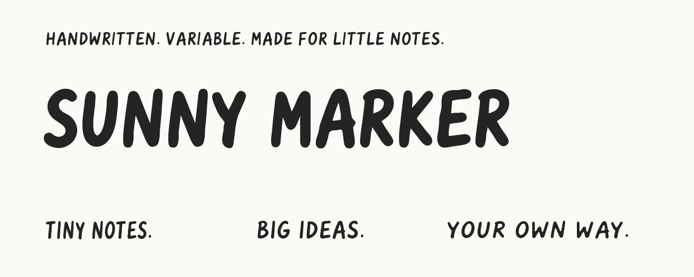

# Sunny Marker

A flexible handwritten marker family for labels, notes, headings, and playful
interfaces. Continuous weight, width, slant and optical size keep the same warm,
irregular character across compact labels and large display type.



[Try the font](https://sunnysdk.com/fonts/sunny-marker/) · [View specimens](https://sunnysdk.com/fonts/sunny-marker/#specimens) · [Browse all 391 glyphs](https://sunnysdk.com/fonts/sunny-marker/#glyphs)

**Latest development:** the [1.314 coverage review candidate](candidates/1.314/)
adds Gothic coverage and fixes the remaining Google Fonts checker failures.
It includes editable sources, downloadable fonts, a visual proof, and full
results: **0 failures/errors, 12 advisory warnings**. The report also documents
the remaining limitation with Google's default split web delivery.
The website, npm package and stable downloads below remain **1.313**.

## Use the fonts

```sh
npm install @sunnyai/sunny-marker
```

```js
import "@sunnyai/sunny-marker/css";
```

Install inside your project. For Next.js, use the optional
[`@sunnyai/sunny-marker/next` loader](packages/sunny-marker/README.md).

### Downloads and formats

Version **1.313** includes a four-axis OpenType variable font and 30 matching static styles.

| Download | What it contains |
| --- | --- |
| [Variable desktop (.ttf)](web/downloads/SunnyMarker-1.313.zip) | One OpenType font with TrueType outlines; adjustable weight, width, slant, and optical size. The ZIP also includes its WOFF2 and license. |
| [Static desktop (.otf)](web/downloads/SunnyMarker-Static-OTF-1.313.zip) | 30 fixed OpenType styles with CFF outlines, plus the license. |
| [Web package](release/sunny-marker-web-1.313.zip) | WOFF2 files, CSS, and a standalone type tester. |

**TTF is OpenType too.** The file extension describes the outline format; it does
not determine whether a font is variable or supports OpenType features. Our
variable font uses TrueType outlines. The `.otf` exports are fixed styles, useful
for applications that do not expose variable controls. See the
[OpenType specification](https://learn.microsoft.com/en-us/typography/opentype/spec/otff#filenames).

For a plain HTML page, copy [`web/`](web/) into your public assets:

```html
<link rel="stylesheet" href="/fonts/sunny-marker/sunny-marker.css">
```

```css
.marker {
  font-family: "Sunny Marker", cursive;
  font-weight: 400;
  font-stretch: 100%;
  font-style: oblique 0deg;   /* 0–9° right lean */
  font-optical-sizing: auto;
  font-synthesis: none;
}
```

| Axis | Minimum | Default | Maximum |
| --- | --- | --- | --- |
| Weight `wght` | 300 Light | 400 Regular | 700 Bold |
| Width `wdth` | 75 Condensed | 100 Normal | 125 Expanded |
| Optical size `opsz` | 10 | 14 | 36 |
| Slant `slnt` | -9° right lean | 0° upright | 0° |

The variable font has ten named instances: five weights at upright and slanted endpoints. Width and slant remain continuously
adjustable. Static styles use display optical size 36. At smaller optical sizes,
lowercase letters grow taller and spacing opens. Slant moves continuously from upright to a 9° right lean in the same file.

The family contains **391 glyphs**, including Latin accents, punctuation,
currencies, eight directional arrows, a sun, star, sparkle, heart, check and cross.
Capital Y has an upright lower stem. Capital I has a bare stem by default;
`ss01` or `salt` selects its barred alternate. Dutch j-acute uses `ccmp`.

See [`documentation/glyph-atlas/`](documentation/glyph-atlas/) for the complete
glyph inventory and rendered plates, and [`web/README.md`](web/README.md) for
integration details. `make preview` opens a local specimen server on port 8766.

## Install in a project

See [`packages/sunny-marker/README.md`](packages/sunny-marker/README.md) for npm,
CSS and Next.js imports. `make npm` (Node.js 24 required) builds and checks the
allowlisted installable archive in `web/downloads/`. It includes one variable
WOFF2, CSS, an optional Next.js loader, setup documentation and the OFL.

## Build from editable sources

Python 3.13 is the tested environment. Use a virtual environment:

```sh
python3 -m venv .venv
. .venv/bin/activate
python -m pip install --upgrade pip==26.2.1
python -m pip install -r requirements-qa.txt
make build
make verify
make check
make audit
```

`make build` compiles committed UFO/designspace sources with fontmake, then
packages matching desktop/web fonts, metadata, checksums and a deterministic ZIP.
The current source and packaged release files are version **1.313**.
The npm package uses version **1.313.0**.
Use `make review` to build, verify and proof the 1.313 candidate without replacing
those release assets.
`make check` runs the unmodified Google Fonts FontBakery profile, including its
network and interpolation checks. Timeouts are errors, not passing results.

The original drawing pipeline remains available: install Potrace 1.16 and run
`make sources` to regenerate the UFOs from the reference artwork and Python
geometry code. This replaces direct UFO edits. See [`CONTRIBUTING.md`](CONTRIBUTING.md).

`SOURCE_DATE_EPOCH` defaults to the project's fixed release epoch. Pinned build
tools and source files support repeatable builds. Generated intermediates,
private configuration and raw audit logs are ignored by Git.

## Google Fonts review

The newest candidate is [1.314](candidates/1.314/), with font-side coverage
changes and a passing unmodified Fontspector profile. Run `make coverage-review`
to rebuild its separate source snapshot. It does not require any upstream
subset-definition change. See its report for the web-delivery limitation and
remaining advisories; acceptance is still subject to Google's review.

The initial proposal in [google/fonts#10972](https://github.com/google/fonts/issues/10972)
was closed for outline-quality improvements. Follow the
[outline review](documentation/OUTLINE_REVIEW.md) for the next candidate;
Sunny Marker has not been accepted into Google Fonts.

The previous [1.313 review package](release/sunny-marker-googlefonts-1.313.zip) contains
the rebuilt outlines, shared accents and mark positioning, separate upright
and italic variable fonts for Google's style controls, specimens, and the
prepared Sam Dunn designer profile. The general font retains continuous slant.

Run `make review` from the pinned environment to reproduce 1.313. Its full,
unmodified Fontspector results and outstanding Google subset-routing findings
are documented in [the candidate report](documentation/GOOGLE_FONTS.md).
This is a resubmission candidate, not an accepted Google Fonts release.

## Project files

- `sources/`: editable UFO masters and designspaces.
- `scripts/`: source generation, fontmake build, packaging and verification.
- `fonts/`: released fonts plus a SHA-256 manifest.
- `web/`: standalone marketing page, type tester, glyph gallery and downloads.
- `references/` and `glyphs/manifest.json`: original drawing inputs.
- `documentation/`: quality results, glyph atlas and release guidance.
- `candidates/1.314/`: latest review fonts, source snapshot, proof and QA results.

## License and credits

Copyright 2026 The Sunny Marker Project Authors. All font styles, sources and build
materials use the **SIL Open Font License 1.1**, with no Reserved Font Names.
See [`OFL.txt`](OFL.txt), [`AUTHORS.txt`](AUTHORS.txt), and
[`CONTRIBUTORS.txt`](CONTRIBUTORS.txt). Documents made with the font do not need
to use the OFL.

Designed and maintained by Sam Dunn, with AI-assisted concept development and
font engineering. See the contribution guide for provenance and attribution.

Sunny brand artwork in `web/branding/` is separate from the font software.
See its `NOTICE.txt`; it is excluded from the npm package.
Specimen artwork has its own [CC BY-SA 4.0 license](documentation/image-license.txt).
The approved [designer portrait](sources/googlefonts/README.md) is provided for
the Google Fonts profile; the font license does not grant separate portrait rights.
