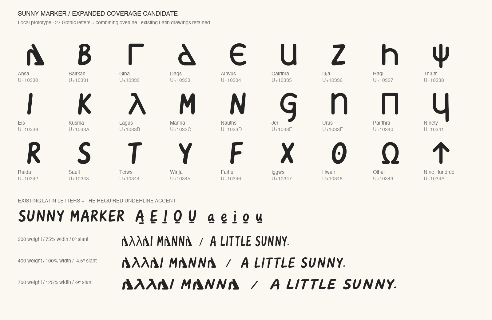

# Sunny Marker 1.314 — coverage review candidate

This snapshot contains the tested font-side changes for the remaining Google
Fonts checker failures. It is a development candidate, not a published npm or
website release. The stable release is still **1.313**.



## Downloads

- [Four-axis desktop font](SunnyMarker%5Bopsz%2Cslnt%2Cwdth%2Cwght%5D.ttf)
- [Complete webfont](SunnyMarker-Variable.woff2)
- [Google Fonts review package](googlefonts/): upright and italic variable fonts,
  family metadata, specimen and the approved designer profile.
- [Editable sources](sources.zip): all 48 UFO masters and the designspace.
- [Checksums](SHA256SUMS)

## Changes

- Adds the complete 27-character Gothic alphabet, U+10330–U+1034A. This is a
  historical script; the addition is real language coverage, with compatible
  drawings and mark anchors in every master.
- Adds U+0305 COMBINING OVERLINE using the existing macron drawing, attachment
  and soft-dot substitution.
- Retains U+0331 COMBINING MACRON BELOW. Google's existing `gothic` subset
  includes that character, and the font now supports that subset's alphabet.
- Removes the optional encoded characters U+1EBC/U+1EBD (Ẽ/ẽ) from the delivery
  candidate. All required Google Fonts Latin Core characters remain.
- Contains **416 glyphs / 401 encoded characters**. Retained Latin drawings,
  spacing and anchors are preserved. Weight, width, optical-size and slant
  ranges are unchanged.

No Google subset definitions, checker code, severity levels or check selections
were changed for the full-profile result. No upstream request was submitted.
The old subset proposal elsewhere in this repository is historical work, not a
dependency of this candidate.

## Recorded verification

Results were recorded on September 17, 2026, before the repository was made
private. They describe the included binaries; they do not claim that Google
can currently access this private repository for onboarding.

| Check | Result |
| --- | --- |
| Unmodified Fontspector 1.7.4 Google Fonts profile, network enabled | **272 PASS, 12 WARN, 0 FAIL, 70 SKIP, 17 INFO, 0 ERROR/FATAL** |
| Seven outline diagnostics at 84 master/intermediate locations | **540 PASS, 48 SKIP, 0 WARN/FAIL/ERROR** |
| Retained-character shaping comparisons against 1.313 | **40,284 passed** |
| Combining-mark checks at 108 axis settings | **11,988 passed** |
| Language samples covered by the declared subset union and complete font | **48 passed** |

The 48 outline skips are the checker's standard italic exemptions. The 12
advisories concern designer registration, vendor ID, optional language/currency
coverage, sparse Latin Extended coverage, characters outside declared delivery
subsets, and width-dependent space metrics. They have not been suppressed.

Read the [full profile](googlefonts.md), [outline report](outlines.md), and
[verification summary](verification.json). Machine-readable reports are included
alongside them. [Source verification](source-verification.json) confirms that
18,720 existing glyph files are byte-identical and the only change to the other
48 is the overline Unicode alias on the existing macron. The new characters were checked against
[Unicode's Gothic chart](https://www.unicode.org/charts/PDF/U10330.pdf); the chart
and third-party font outlines are not included. These results do not replace a
specialist script/design review or guarantee Google Fonts acceptance.

## Web delivery limitation

Google's default script-split delivery can still put a Latin letter and its
combining underline in separate files. Browser testing reproduced fallback for
those clusters even though the checker's union-of-subsets test passes.

Use the **complete WOFF2** for self-hosting. A single subset containing all
requested characters also rendered pixel-identically to the complete font in
four browser samples. Google's existing CSS API supports such requests through
[`text=`](https://developers.google.com/fonts/docs/css2#optimizing_your_font_requests).
This behavior was verified using a read-only request for Noto Sans Gothic.

[google-fonts-request.txt](google-fonts-request.txt) prepares the request for
Sunny Marker **after onboarding**. Sunny Marker is not currently available from
Google's API; its Google-hosted delivery has not been tested. See the
[browser results](browser-verification.json) for the successful single-file
comparisons and the default split differences.

## Rebuild from this snapshot

Install the pinned dependencies in the root `requirements-qa.txt`, then run:

```sh
make coverage-review
make coverage-verify
```

This verifies and extracts `sources.zip`, compiles all 48 masters with fontmake,
rebases the optical-size default to 14, applies the candidate's repertoire and
metadata, and exports its four-axis TTF/WOFF2 and Google-style fonts under
`build/coverage-candidate-1.314/`. It does not replace stable assets.
`python scripts/build_coverage_candidate.py --sources-only` extracts just the
editable sources. `make coverage-verify` checks the archived fonts and checksums;
to run those shaping and repertoire checks on a rebuild instead, use:

```sh
python scripts/verify_coverage_candidate.py 'build/coverage-candidate-1.314/SunnyMarker[opsz,slnt,wdth,wght].ttf'
```

The archived binaries are the exact files covered by the recorded reports.
A fresh full build reproduced the four-axis TTF and WOFF2 byte for byte; all
44,928 glyph/location outline comparisons matched too. The Google-style
exports can differ in equivalent name-table or variation-table packing.
Use checksums to distinguish the archived, tested binaries from any rebuild.

Font files and source drawings are covered by [OFL.txt](OFL.txt). Specimen and
designer-portrait permissions are documented in the Google Fonts package.
