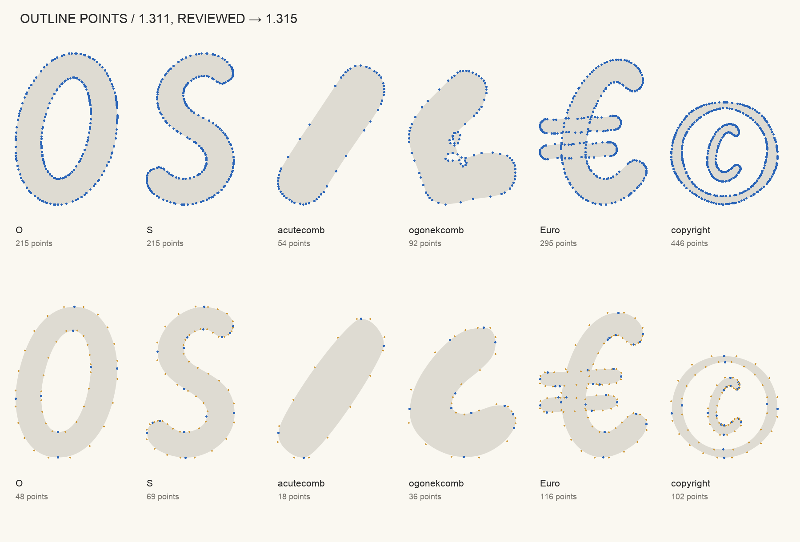
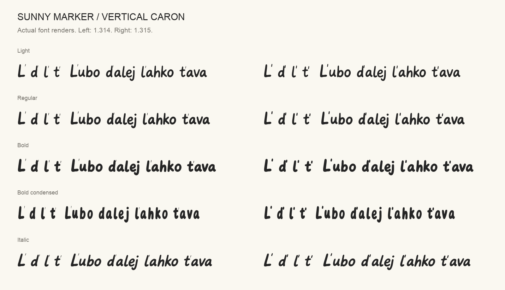

# Sunny Marker 1.315 — outline review candidate

This candidate answers the Google Fonts outline review of 1.311
([google/fonts#10972](https://github.com/google/fonts/issues/10972)): far fewer
points, a node at every extreme, no near-straight joins, and a vertical caron
that matches the other marks. It is a development candidate, not a published
npm or website release. The stable release is still **1.313**.



## Downloads

- [Four-axis desktop font](SunnyMarker%5Bopsz%2Cslnt%2Cwdth%2Cwght%5D.ttf)
- [Complete webfont](SunnyMarker-Variable.woff2)
- [Google Fonts package](googlefonts/): upright and italic variable fonts,
  family metadata, article, specimen and the designer profile.
- [Editable sources](sources.zip): all 48 UFO masters and the designspace.
- [Checksums](SHA256SUMS)

## Changes from 1.314

- **Refit outlines.** Every master is redrawn with fewer nodes, staying within
  6 units (UPM 1000) of 1.314's drawing. Every horizontal and vertical extreme
  has a node, lines that are nearly straight continuations are merged, and lines
  within 0.6° of horizontal or vertical are made exact in the upright masters.
  The italic masters keep their 9° slant. All 48 masters keep matching point
  structures, so the font still interpolates.
- **Vertical caron.** ď ľ ť Ľ used a fixed 19-unit wedge in every weight, while
  every other mark is a 57–89 unit marker stroke. The mark is now drawn from each
  master's own acute at 85% of the apostrophe's weight, so it gets heavier with
  the weight axis. The four letters are wider where the heavier mark needs room,
  by at most 107 units. They are the only characters whose advance changes, and
  none of them has kerning pairs.
- **No Gothic.** 1.314 added the Gothic alphabet (U+10330–U+1034A) only so that
  Google's `gothic` subset would serve U+0331. That is not a reason to claim a
  script, so 1.315 leaves it out: **389 glyphs / 374 encoded characters**.
- **Repository links** now point to
  [github.com/samdunn/sunny-marker-font](https://github.com/samdunn/sunny-marker-font).

Anchors, components, kerning, vertical metrics and every other advance are
unchanged. Weight, width, optical-size and slant ranges are unchanged.



## Outline counts

Measured with [`scripts/audit_outline_counts.py`](../../scripts/audit_outline_counts.py)
([results](outline-counts.json)). Points are counted for the 223 characters all
three versions share, at the default location, with components decomposed.
Segment findings use Fontspector's rules in static instances at every axis
corner plus the default.

| | 1.311 (reviewed) | 1.314 | 1.315 |
| --- | ---: | ---: | ---: |
| Median points per character | 187 | 93 | **77** |
| Most points in one character | 446 | 197 | **148** |
| Node-to-node hops under 10 units | 20,650 | 59 | **32** |
| Near-straight line joins | 484,877 | 11,766 | **0** |
| Short segments | 465,192 | 53,342 | **24,127** |
| … of which are lines | 465,192 | 77 | **0** |
| … of which are under 3 units | 20,463 | 570 | **232** |

1.311 is one four-axis font (17 instances); 1.314 and 1.315 are the upright and
italic Google fonts (18 instances).

Fontspector's short-segment, near-straight and alignment checks treat more than
100 findings in a font as intentional and report PASS. 1.314's clean outline
result came from that cutoff, not from clean outlines; the table counts every
finding. In 1.315, 98% of the remaining short segments are pieces of a single
TrueType curve between implied on-curve points, which is how a smooth cubic
curve is stored as quadratics. None are lines.

[Before and after renders](proof/before-after.png) ·
[Point counts for the proof glyphs](proof/point-counts.json)

## Recorded verification

Recorded on October 27, 2026 with the archived binaries in this folder.

| Check | Result |
| --- | --- |
| Unmodified Fontspector 1.9.0 Google Fonts profile, network enabled | **282 PASS, 12 WARN, 5 FAIL, 69 SKIP, 17 INFO, 0 ERROR/FATAL** |
| All seven outline checks on 18 static instances | **117 PASS, 9 SKIP, 0 WARN/FAIL** |
| Outline checks on the two variable fonts | **6 PASS, 8 SKIP** |
| Shaping identical to 1.314 at 108 axis settings | **39,960** characters and **3,240** mark sequences |
| Outline distance from 1.314 at 108 axis settings | **39,312** comparisons; largest 7.98 units, median 4.72 |
| Vertical caron at 108 axis settings | never narrower than 1.314; at least 4.9 units from its letter; 34 units thick at wght 300, 52 at 700 |
| Source geometry regression tests | **16 passed** |

All five failures come from one check, `googlefonts/tofu`, and one character
(see below). The 12 warnings are the same 12 that 1.314 gets from Fontspector
1.9.0: optional extra letters for a few languages (Ŧ ŧ Ǿ ǿ and others), the
Indian rupee sign, vendor ID `NONE`, the designer profile not yet in Google's
catalog, sparse `latin-ext` coverage, marks and symbols outside the declared
subsets, and the space glyph's width-dependent sidebearing. None were
suppressed. The 9 static-instance skips are the italic exemption for the
near-axis check; the variable-font run skips four checks that Fontspector only
runs on static fonts.

Reports: [full profile](googlefonts.md) ([JSON](googlefonts.json)),
[static-instance outlines](outlines.md) ([JSON](outlines.json)),
[variable-font outlines](outlines-variable.md) ([JSON](outlines-variable.json)),
[verification against 1.314](verification.json),
[refit per glyph](refine-outlines.json),
[vertical caron per master](vertical-caron.json).

## The remaining failure

U+0331 COMBINING MACRON BELOW appears in Google's sample texts for Amarakaeri,
Chickasaw, Otomi (Mezquital), Secoya and Siona. The font draws and positions
it, but Google's `latin` and `latin-ext` subsets do not include it, so the web
API would not serve it. Removing the character does not help: 1.311 lacked it
and failed the same check for a missing glyph. Fixing it needs a change to
Google's subset definitions; see
[missing combining marks](https://github.com/googlefonts/nam-files/issues/6) and
[combining-mark distribution](https://github.com/googlefonts/nam-files/issues/23).

## Rebuild from this snapshot

Install the pinned dependencies in the root `requirements-qa.txt`, then run:

```sh
make outline-sources   # 1.314 sources → refit → caron → sources.zip
make outline-review    # sources.zip → fonts in build/outline-candidate-1.315/
make outline-verify    # archived fonts and checksums against 1.314
```

`make outline-sources` starts from the archived 1.314 sources and reproduces
`sources.zip` byte for byte. With the pinned dependencies, `make outline-review`
then rebuilds the four-axis TTF, the WOFF2 and both Google fonts byte for byte.

To recount outlines:

```sh
python scripts/audit_outline_counts.py \
  --font 1.315 'candidates/1.315/googlefonts/ofl/sunnymarker/SunnyMarker[opsz,wdth,wght].ttf' \
  --font 1.315 'candidates/1.315/googlefonts/ofl/sunnymarker/SunnyMarker-Italic[opsz,wdth,wght].ttf'
```

Font files and source drawings are covered by [OFL.txt](OFL.txt). Specimen and
designer-portrait permissions are documented in the Google Fonts package.
