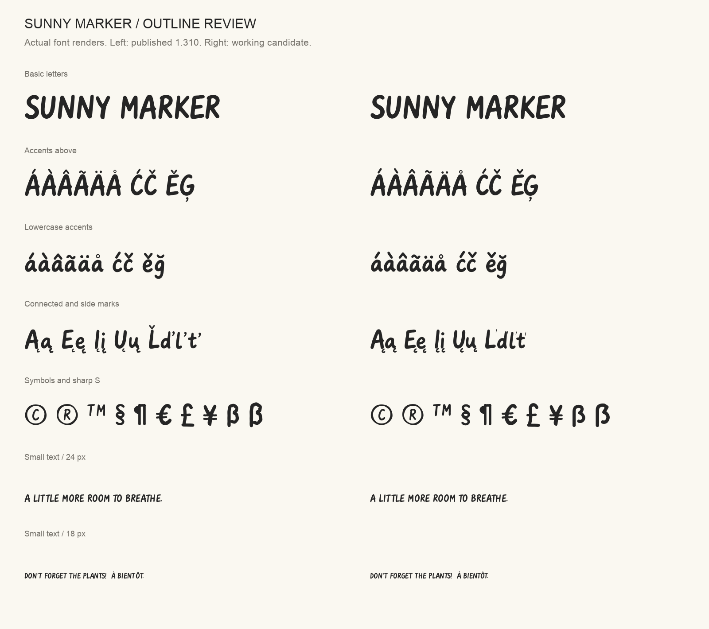
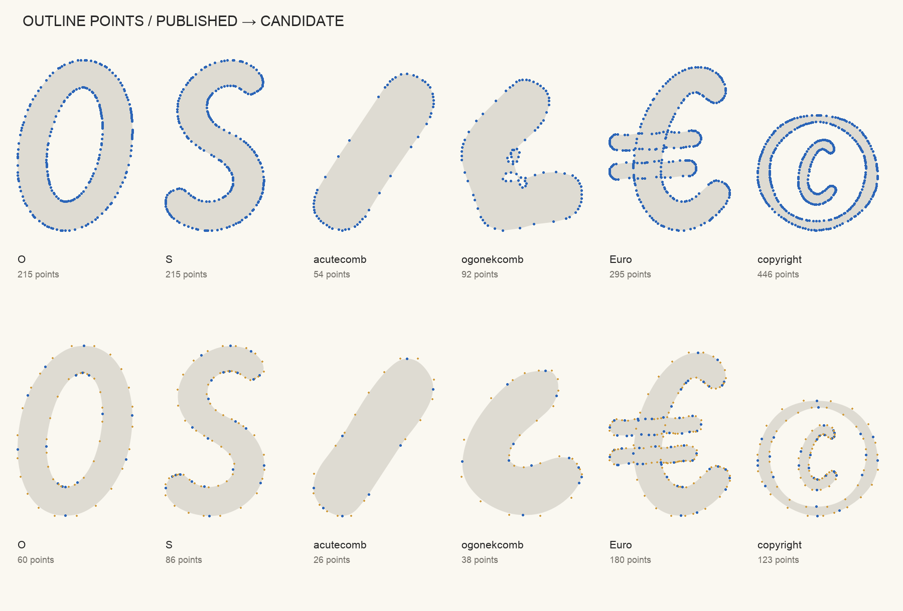

# Outline quality review — 1.312

This candidate addresses the [Google Fonts review](https://github.com/google/fonts/issues/10972#issuecomment-5714431859)
of symbols, accents and excessive outline points. It is ready for another design
review, with remaining findings disclosed below. Acceptance still requires
Google's judgment and resolution of the [subset-routing findings](GOOGLE_FONTS.md#remaining-google-fonts-failures).
The website, npm package and published desktop downloads remain **1.310**.

## What changed

- Replaced dense sampled polylines with compatible cubic curves across all 48
  masters. Shared segmentation uses a two-unit bidirectional sampled fit
  tolerance at 1000 units per em. Float coordinates survive until compilation.
- Redistributed samples around offset joins, repaired tiny offset loops, and
  rounded 58 shared sharp joins in the final curves. Star and sparkle tips remain
  pointed. All masters retain matching contour topology.
- Corrected curve reversal and contour winding. Placement uses curved ink bounds
  instead of control-handle bounds. Ring and degree counters remain nested at
  every master; miniature letters use a proportionate marker stroke.
- Redrew sharp S, ogoneks, side carons and Eng; balanced symbols and mathematical
  signs. The hollow `.notdef` and outlined heart have appropriate counters.
- Rebuilt accented letters with shared base/mark components. Advances and kerning
  follow their bases. Capitals and ascenders use compact top marks; accents
  follow changing letter height at small optical sizes.
- Added real mark-to-base and mark-to-mark positioning, mark classes, zero-width
  combining marks, soft-dot removal and contextual caron/Latvian-g forms.
  Added missing language-sample characters and extended accent combinations.

## Visual proofs





All **391 glyphs**: [plate 1](outline-review/glyphs-01.png),
[plate 2](outline-review/glyphs-02.png), [plate 3](outline-review/glyphs-03.png),
[plate 4](outline-review/glyphs-04.png), [plate 5](outline-review/glyphs-05.png).

Also reviewed: [small optical-size extremes](outline-review/extremes-opsz10.png),
[display optical-size extremes](outline-review/extremes-opsz36.png), and
[language and stacked-mark proof](outline-review/language-proof.png).
Text proofs use HarfBuzz shaping, including actual mark attachments; glyph plates
show individual outlines. These are generated from the candidate font.

## Measured results

| Check | Result |
| --- | --- |
| Glyph count | 336 → **391** |
| Expanded outline points, counting component use | 63,565 → **36,653**, 42.3% fewer |
| Stored simple-outline points | 63,565 → **15,789**; includes shared-component savings |
| Complete-glyph bounds | **51** locations, no overflow |
| Variable shaping / width progression | **375** locations passed |
| Canonical composed/decomposed pairs | **177 pairs × 108 locations** passed |
| Mark attachment and language strings | **18 strings × 108 locations** passed |
| Source-to-compiled edge comparisons | **1,164**, maximum sampled deviation **1.64 units** |
| Source geometry regression tests | **9 passed** |
| Google upright/italic split | **162 shaping comparisons** passed |
| General desktop/web export validation | **92 files**, including all 30 static styles, passed |

Edge deviation measures compilation of the revised sources, not differences from
the old design. A sampled bound is not a mathematical proof over every possible
curve point or variable location.

Reports: [geometry](outline-review/geometry-check.json),
[layout](outline-review/layout-check.json),
[submission package](outline-review/submission-check.json),
[curve fitting](curve-fitting.json),
[general-release FontBakery summary](outline-review/fontbakery-summary.json).

## Outline warning review

Fontspector **1.7.4** outline checks on all **48 master locations**:
**272 PASS / 40 WARN / 24 SKIP / 0 FAIL / 0 ERROR**.
The temporary static faces isolate evaluated outlines for these checks; they are
diagnostic files, not the distributed static fonts.

- **24 near-axis warnings:** marker flanks intentionally depart slightly from
  exact horizontal or vertical lines. Retained after visual review.
- **10 overlapping-segment warnings:** local integer rounding leaves tiny or
  zero-length segments in a few instances, including W/w, 4, ampersand, TM,
  Dcroat, m and the southwest arrow. These are residual geometric imperfections,
  not perfectly minimal outlines. The evaluated examples are at most a few font
  units and produced no visible defects in the reviewed proofs.
- **6 sharp-join warnings:** chiefly the pointed star/sparkle, with tiny residual
  joins in the condensed slanted medium g, trademark and feminine ordinal.
  These remain disclosed for the reviewer rather than removed from the checks.

Contour-direction warnings are resolved at all 48 locations. No checks were
excluded or downgraded. See the [complete outline report](outline-review/outlines.md)
and [machine-readable results](outline-review/outlines.json). The separate
**full Google Fonts profile still reports 9 subset-routing failures**; see
[the onboarding report](GOOGLE_FONTS.md).

## Reproduce

Use the pinned Python environment in the README. `make review` compiles committed
editable sources, verifies geometry and shaping, renders proofs and builds the
Google Fonts package without replacing published fonts or web files.

```sh
make review
```

To regenerate editable sources from the drawing inputs first, install Potrace
1.16 and run `make sources`. To validate all general-release formats, run
`make package`, `make verify`, and `make check` in a disposable checkout: those
commands intentionally regenerate release assets in that checkout.

Dependency audit, Bandit and Gitleaks found no reported vulnerabilities, medium/
high code-security findings or secrets in the checked tree and archives. Public
commit identities use GitHub noreply addresses. This is a scoped audit, not a
guarantee against every possible issue.

References: [Google Fonts outline quality](https://googlefonts.github.io/gf-guide/outlines.html),
[diacritics](https://googlefonts.github.io/gf-guide/diacritics.html), and
[quality assurance](https://googlefonts.github.io/gf-guide/qa.html).
