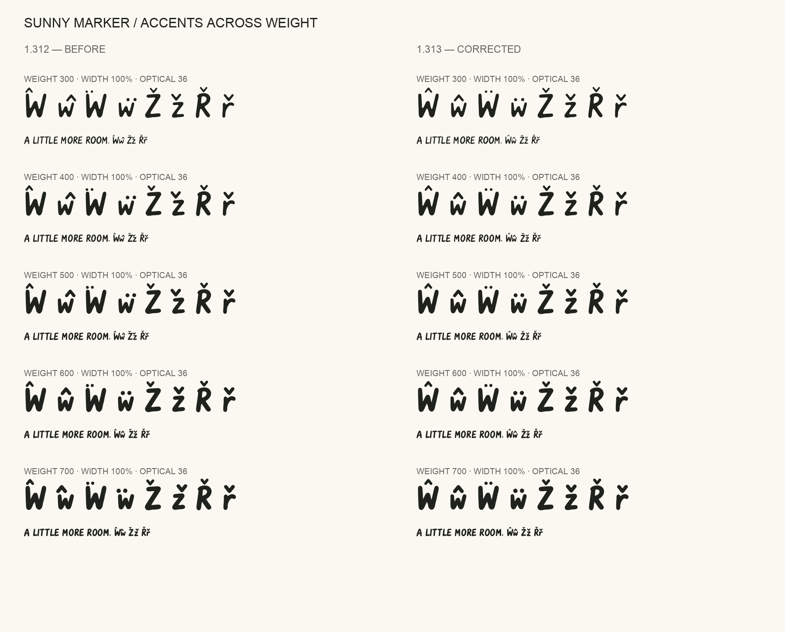
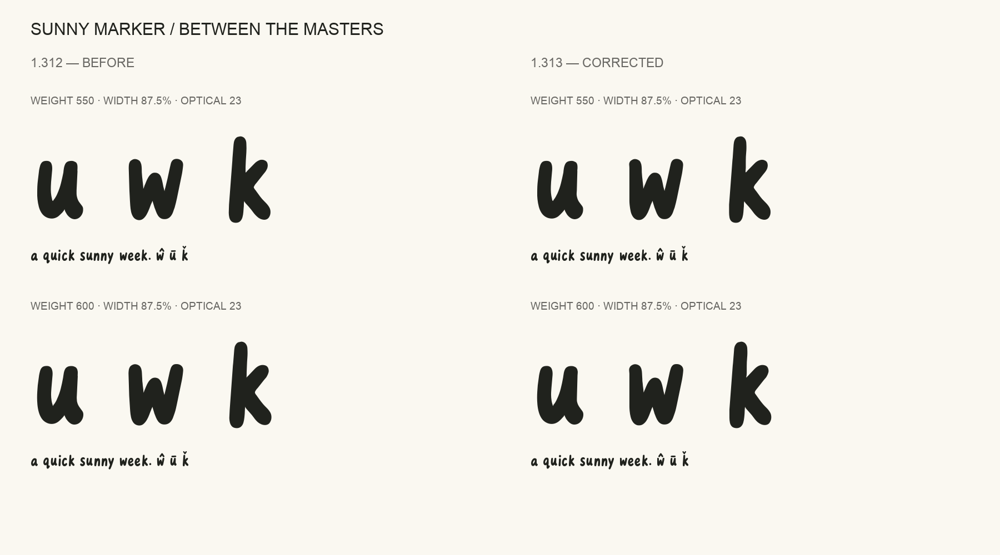

# Outline quality review

## 1.315

The [1.315 candidate](../candidates/1.315/) is the answer to the
[Google Fonts review](https://github.com/google/fonts/issues/10972#issuecomment-5714431859)
of 1.311, which named symbols, accents and the number of points on outlines.

- Every master is refit with fewer nodes, within 6 units of 1.314's drawing,
  with a node at every horizontal and vertical extreme. Near-straight line
  joins are merged, and near-axis lines are made exact in the upright masters.
- The vertical caron of ď ľ ť Ľ, a fixed hairline wedge since 1.312, is now a
  marker stroke that follows the weight axis.
- The Gothic alphabet added in 1.314 for subset routing is left out.

| | 1.311 (reviewed) | 1.314 | 1.315 |
| --- | ---: | ---: | ---: |
| Median points per character | 187 | 93 | **77** |
| Near-straight line joins | 484,877 | 11,766 | **0** |
| Short segments that are lines | 465,192 | 77 | **0** |
| Short segments under 3 units | 20,463 | 570 | **232** |

**A correction to earlier results.** Fontspector's short-segment, near-straight
and alignment checks treat more than 100 findings in a font as intentional and
report PASS. The clean outline results recorded for 1.313 and 1.314 came from
that cutoff: 1.314 had 11,766 near-straight joins and 53,342 short segments.
1.315 is measured with [`scripts/audit_outline_counts.py`](../scripts/audit_outline_counts.py),
which applies the same rules and counts every finding.

Methods, all checker results and the one remaining Google Fonts failure are in
the [candidate README](../candidates/1.315/README.md).

## 1.313 results (historical)

These describe the 1.313 release. Its outline results are affected by the
cutoff described above.

**Quality record for the 1.313 release. Google Fonts resubmission remains on hold.**
This continues the work prompted by the [Google Fonts review](https://github.com/google/fonts/issues/10972#issuecomment-5714431859).
The outline checks now have **zero warnings or failures at 84 evaluated locations**.
The full Google Fonts profile still has nine subset-routing failures, explained in
[the onboarding report](GOOGLE_FONTS.md). This is not a claim of Google acceptance.
The same checked outlines are packaged for the 1.313 web and desktop release.

### Improvements in this pass

- Removed 421 shared short curve segments using tangent-preserving fits bounded
  to two units at sampled parameters in every master. Shared topology is retained.
- Aligned near-horizontal/vertical flanks while preserving italic shear.
- Rebuilt W's filled boundary to remove offset loops and tiny pinholes. Tests
  check both upper strokes and a single filled contour across all 84 locations.
- Opened pinched ampersand counters and softened small joins in the feminine
  ordinal, star and sparkle. Their overall marker shapes are retained.
- Rounded u/w/k joins that became sharp **between** the weight masters. The
  regression suite specifically tests those intermediate settings.
- Replaced sample-density-based accent centering with a stable upper-ink span.
  Accents no longer jump from one side of w or z to the other across weight.
  Shared components and combining-mark positioning follow the same anchors.
- Made anchor updates idempotent so repeated processing cannot accumulate drift.

The earlier revision replaced dense polylines with compatible cubic curves,
balanced symbols, rebuilt accents as components, and added mark-to-base and
mark-to-mark positioning, soft-dot removal and contextual language forms.

### Visual proofs





[Small outline repairs](outline-review/outline-repairs-comparison.png) ·
[Original versus rebuilt outlines](outline-review/before-after.png) ·
[Point comparison](outline-review/outline-points.png)

All **391 glyphs**: [plate 1](outline-review/glyphs-01.png),
[plate 2](outline-review/glyphs-02.png), [plate 3](outline-review/glyphs-03.png),
[plate 4](outline-review/glyphs-04.png), [plate 5](outline-review/glyphs-05.png).
Also reviewed: [small-size extremes](outline-review/extremes-opsz10.png),
[display extremes](outline-review/extremes-opsz36.png), and
[languages and stacked marks](outline-review/language-proof.png).
Text proofs use HarfBuzz shaping; individual glyph plates show the actual outlines.

### Measured results

| Check | Result |
| --- | --- |
| Glyph count | 336 → **391** |
| Expanded outline points, counting component use | 63,565 → **35,501**, 44.2% fewer |
| Stored simple-outline points | 63,565 → **15,235**; includes component reuse |
| Complete-glyph bounds | **51** locations; no overflow |
| Variable shaping and width progression | **375** locations passed |
| Canonical composed/decomposed pairs | **177 × 108 locations** passed |
| Mark attachment and language strings | **18 × 108 locations** passed |
| Source-to-compiled edge comparisons | **1,164**; maximum sampled deviation **1.55 units** |
| Source geometry regressions | **16 passed** |
| Before/after source ink comparisons | **9,984 passed**; no additional filled contours |
| Upright/italic Google style split | **162 shaping comparisons** passed |
| Desktop and web export validation | **92 files** passed; includes all 30 static styles |

The source-to-compiled comparison measures compilation, not design changes.
The separate before/after ink audit samples boundaries at one-unit spacing.
It counts contours over 0.5 square units and excludes fragments at or below four
square units from distance measurements; disappearing microscopic holes otherwise
inflate that distance. W's deliberate counter repair has a 40-unit acceptance
limit; other glyphs have a 12-unit limit. Actual deviations and thresholds are
listed in the [independent report](outline-review/source-polish-verification.json).
These sampled tests are not a proof over every possible variable coordinate.

Reports: [geometry](outline-review/geometry-check.json),
[layout](outline-review/layout-check.json),
[source polishing](outline-review/source-polish.json),
[submission integrity](outline-review/submission-check.json),
[92 exports](outline-review/export-verification.json).

### Outline QA

Fontspector **1.7.4**, all seven outline checks including overlapping segments,
on **48 master + 36 intermediate locations**:
**540 PASS / 48 SKIP / 0 WARN / 0 FAIL / 0 ERROR**.
The 48 skips are the tool's italic exemption for the near-axis check.
No severity was changed and no individual outline check was suppressed.
The temporary static diagnostic faces evaluate the variable font at each location;
they are not distributed static styles.

[Full outline report](outline-review/outlines.md) ·
[Machine-readable results](outline-review/outlines.json)

### Reproduce

Use the pinned environment from the README. `make review` compiles editable UFOs,
verifies geometry and shaping, renders proofs and builds the Google package.
To regenerate the editable sources first, install Potrace 1.16 and run `make sources`.

```sh
make review
fontspector -p googlefonts -c outline_ -c overlapping_path_segments \
  --json build/outlines.json --ghmarkdown build/outlines.md \
  build/resubmission-review/instances/*.ttf
```

To check all general-release formats, run `make package` and `make verify` in a
disposable checkout; those commands regenerate its release assets. This review's
92-format check used an isolated output directory, leaving published assets intact.
Bandit reported no medium/high findings; Gitleaks reported no leaks in the local audit.
FontBakery **1.1.0** also completed on the final general variable font and six
representative static exports: **581 PASS / 12 WARN / 319 SKIP / 26 INFO /
0 FAIL / 0 ERROR**. Its older profile does not replace the current Fontspector
onboarding result. [Summary](outline-review/fontbakery-summary.json).

The general-package advisories include its 1.6 MB four-axis file, absence of an
article in that general package, the disclosed routing/coverage/vendor items,
and an A/AE interpolation warning. The Google package has separate sub-1 MB
styles and includes an article.

The A/AE warning averages two diagonal weight/width corners, ignoring intervening
masters. [Targeted verification](outline-review/interpolation-warning-review.json)
evaluates **404 glyph/location combinations** along those paths: the reported joins' maximum
deviation is **0.69 units**, below FontTools' two-unit threshold. The warning is
retained for review; this is a sampled explanation, not a universal guarantee.
The six static contour-count advisories compare stroke/component counts with
conventions from other fonts; the affected drawn forms are included in the glyph
proofs. Current Google onboarding results remain in [GOOGLE_FONTS.md](GOOGLE_FONTS.md).
